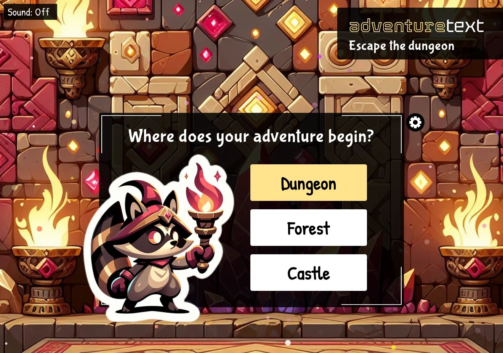

# Text Adventure

A personal learning project: a text adventure game where GPT-4o generated the rooms and story, and DALL·E 3 generated the art, in real time. Built to learn generative AI application development and prompt engineering hands-on.

<p align="center">
  
</p>

**[👉 Live demo](https://kellygorr.com/websites/text-adventure)** — the OpenAI backend is no longer running; this build replays a scripted playthrough instead (see [On-rails build](#on-rails-build) below).

## For Developers

### Installation

```sh
npm install
npm start
```

### Tech Stack

- React + TypeScript
- Create React App (`react-scripts`)
- `react-router-dom`

### Architecture

```
src/
├── Intro/       # Start screen, adventure selection
├── Adventure/   # Core gameplay: map, rendering, action classification
├── End/         # End-game screen
└── utilities/
    ├── GameData.ts              # Room/item/obstacle content graph
    ├── GameProps.ts             # Shared types and enums
    ├── scriptedPlaythrough.ts   # On-rails build's canned AI responses
    └── context/                 # Shared game-state context
```

### On-rails build

This repo's current build has zero backend/API dependency and zero ongoing cost. The real app's two network calls (`POST /api/generateGameImage` and `POST /api/playerAction`) are replaced with a static, pre-authored playthrough in [`src/utilities/scriptedPlaythrough.ts`](src/utilities/scriptedPlaythrough.ts) — every turn in that file was traced against `determineAction.ts`'s real classification logic to confirm it resolves correctly against the actual game-state graph, not just written to "look right." Everything else — the action classification, the room/item/obstacle graph, and all game-state transitions — is the same, unmodified engine code from the original AI-backed app.

### Engineering highlights

The hardest problem wasn't generating content, it was trusting it.

- **Turning unreliable AI output into reliable game state** — rather than treating the model's narration as the source of truth, the app tracked its own game state (inventory, room state, progression). The model could enrich the experience without being allowed to rewrite history or invent new obstacles — for example, claiming an avalanche blocked a door the player had already opened.
- **Fallback recovery when the model misunderstood an action** — the app asked the model to classify the player's action type (`Move | Use | Investigate | PickUp`). When that classification failed, rather than confusing the model further with the normal guardrails, a reframing fallback prompt gave it another chance. For example: if a pick-up action didn't return the expected item, the game told the player they'd dropped the item, prompting them to try again.
- **Keeping the model inside the game's constraints** — see `src/Adventure/determineAction.ts` for the action-classification logic (verb/keyword matching, item and location tag matching, single-exit fallback, obstacle keyword matching) that mediates between free-form model output and deterministic game state.

## Credits

Background and character art generated with DALL·E 3; all other code and content by me.
